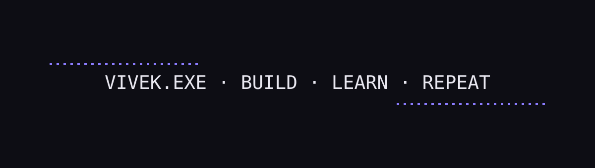

  
  <h1>Hi, I'm Vivek 👋</h1>
  <h3>Software Developer · AI/ML · Backend</h3>
  
<code>building things that think & feel</code>

  
Designing practical ML systems, reliable APIs, and tools that solve real problems.

  
<a href="https://naivete07.github.io/Portfolio/">Portfolio</a> · <a href="https://www.linkedin.com/in/vivek-yadav-sde">LinkedIn</a> · <a href="mailto:vivekyaduvanshi712@gmail.com">Email</a>

---

<h2 align="center">🚀 About Me</h2>

I'm a third-year <b>B.Tech CSE (AI/ML)</b> student at <b>ABES Engineering College</b>. I enjoy taking ideas from data and models all the way to dependable, usable software.

- Building end-to-end ML systems, APIs, and dashboards
- Exploring <b>FastAPI, model evaluation, and scalable backend design</b>
- <b>GDG ABESEC Production Lead</b> and Dev2Hack 2026 Final Six
- Open to <b>ML platform and backend internships</b>

<h2 align="center">🧩 Featured Work</h2>

| Project | What it does |
|---|---|
| [Aegisguard · Fraud Detection](https://github.com/Naivete07/Aegisguard-Fraud-Detection) | Hybrid XGBoost + Isolation Forest detection, SHAP explanations, and a FastAPI + React dashboard. Reached **0.971 PR-AUC** on Sparkov. |
| [KAYO · Scam & Threat Recognition](https://github.com/Naivete07/KAYO) | Threat-pattern recognition across financial and network data; a **Dev2Hack 2026 Final Six** project. |
| [SEARIS · Sea Intelligence](https://naivete07.github.io/Portfolio/#work) | Underwater object detection and classification prototype built at the SGU × RocketRide AIthon. |
| [Hotel Management System](https://github.com/Naivete07/Hotel-Management-LLM-model) | Flask-based hotel assistant with LLM replies, autocomplete, bookings, and amenities. |

<h2 align="center">🛠️ Tech Stack</h2>

  
  
  
  
  
  
  
  

<h2 align="center">📊 GitHub Activity</h2>

  
  

<h2 align="center">🤝 Connect</h2>

  
  
  
  

Thanks for stopping by — let's build something useful.

